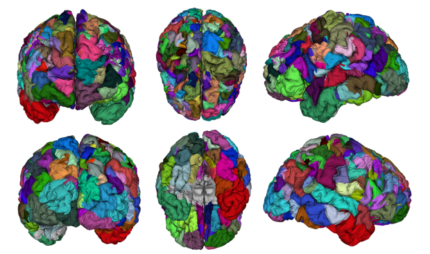
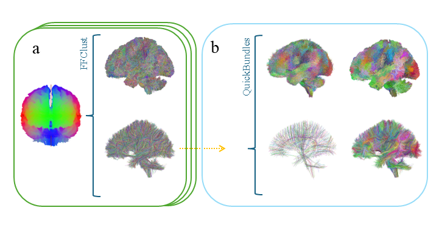
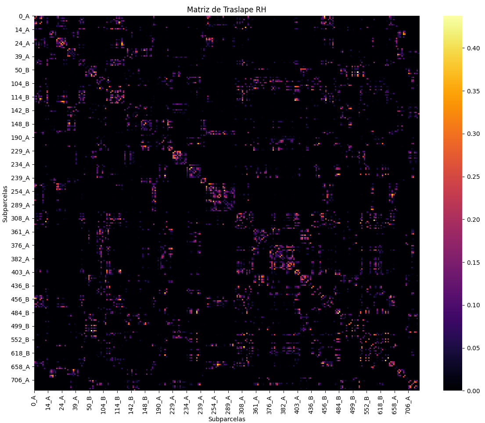
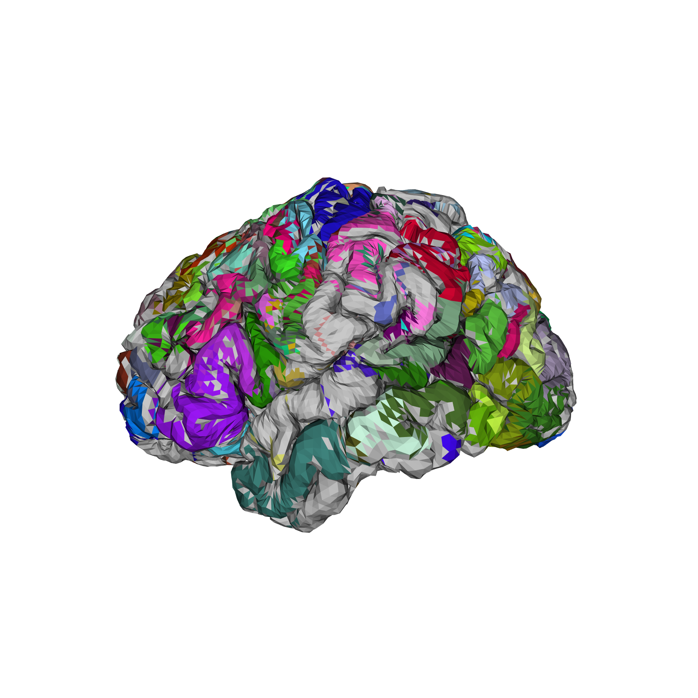
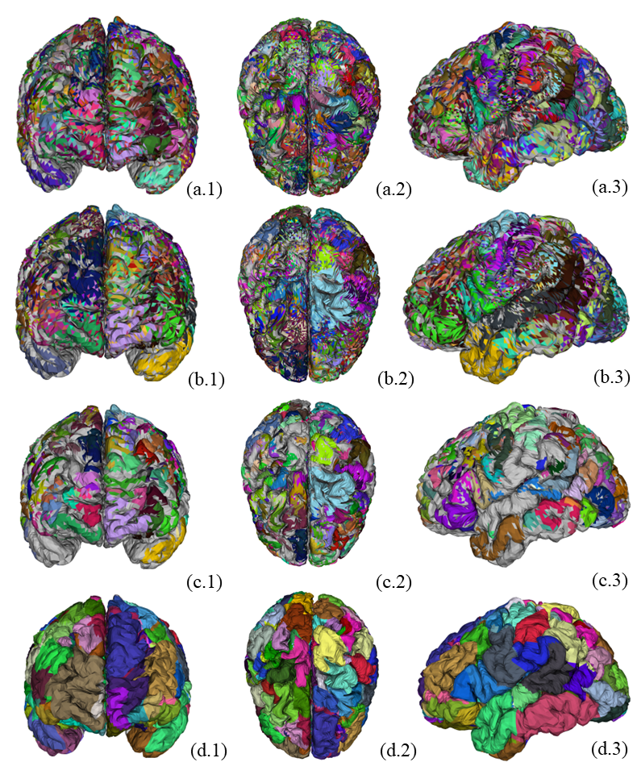
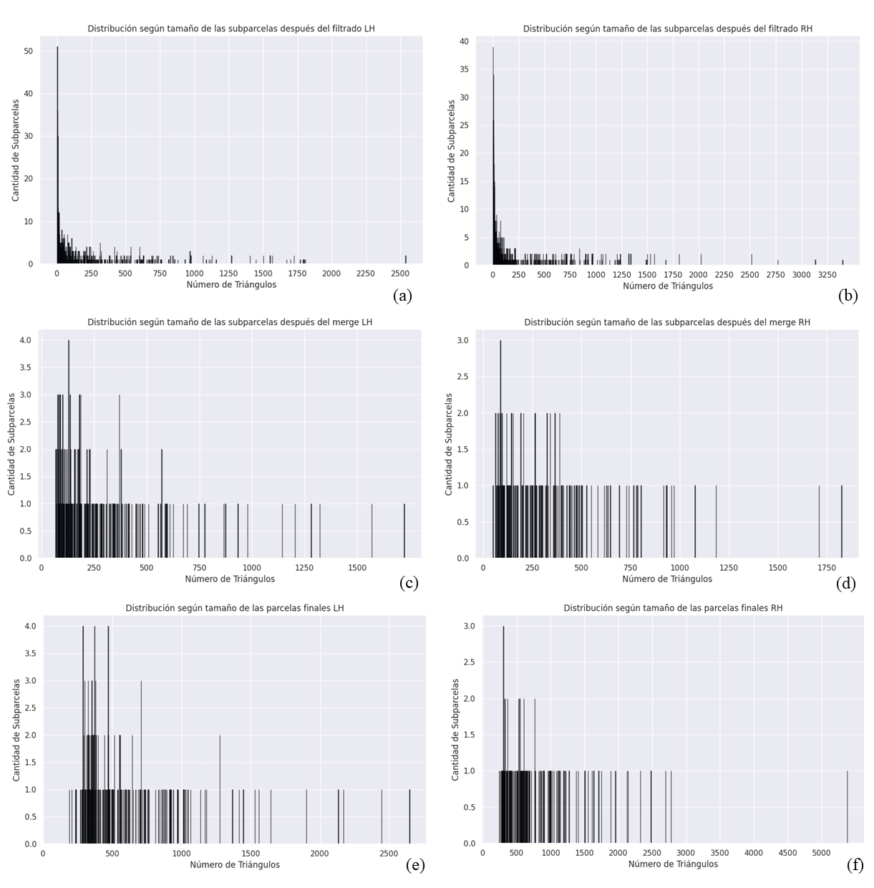

# Cortical parcellation from structural connectivity (HCP-YA)

Research code from my engineering thesis at the Universidad de Concepción: an algorithm that divides the human cerebral cortex into regions based on how they are wired together, using white-matter tractography and cortical meshes from 100 subjects of the Human Connectome Project (Young Adult).

- **Thesis (Spanish):** [`docs/thesis-memoria-de-titulo-2025.pdf`](docs/thesis-memoria-de-titulo-2025.pdf), *Algoritmo de parcelación cerebral intersujeto basado en datos del Proyecto del Conectoma Humano* (Civil Biomedical Engineering, April 2025).
- **Author:** Martín López Aguilera. **Supervisor:** Pamela Guevara. **Co-supervisor:** Cecilia Hernández. **Committee:** Pablo Aqueveque.

> **Status:** research prototype, not a packaged tool. The scripts use hard-coded paths, the data is not included, and this repository holds a snapshot of the code from July 2024. The thesis describes the final method and results in full. Parameter defaults in `main.py` (for example the 60 mm fiber filter) differ from the values reported in the thesis (40 mm).

## What it does

Input: probabilistic tractograms (3 million fibers per subject, 21 points per fiber, MNI space) and a cortical mesh per hemisphere (81,920 triangles).

1. **Preprocess.** Remove short fibers (below 40 mm in the thesis, to fit in memory) and smooth the rest with a moving average. About 834,000 fibers per subject remain.
2. **Cluster within each subject** with FFClust (the number of initial clusters is chosen with the elbow method). Keep each cluster's centroid.
3. **Cluster across subjects.** Move all centroids to a common space and group them with QuickBundles (θ = 10 mm). Keep only clusters that contain centroids from at least 88 of the 100 subjects: about 1,025 clusters per subject.
4. **Intersect with the cortex.** For each fiber, find the first and last triangle it crosses on the mesh. The set of triangles a cluster touches is a *subparcel*.
5. **Resolve overlaps.** Subparcels overlap heavily. Estimate for each triangle the probability of belonging to each subparcel, define *density centers*, build an overlap matrix and graph, and merge the strongly overlapping subparcels.
6. **Grow the parcels.** Keep the largest connected component of each subparcel and expand them with iterative morphological dilation, deciding contested triangles from the raw fiber counts.

Output: a single parcellation per hemisphere, **189 parcels on the left and 139 on the right (328 in total)**.

### Final result

*The final parcellation drawn on the cortical surface, six views. Each color is one parcel.*

### How the pipeline works, step by step

*Steps 2 and 3. (a) Each subject's tractogram is clustered with FFClust. (b) The cluster centroids of all subjects are moved to a common space and grouped with QuickBundles; only clusters shared by at least 88 of the 100 subjects are kept.*

*Step 5. Overlap matrix between subparcels (right hemisphere). Each row and column is a subparcel; brighter cells mean more shared triangles. The bright blocks are groups of subparcels that overlap strongly and are candidates to be merged.*

*Step 6. A snapshot of the dilation: each parcel grows from its main connected component into the free neighboring triangles (grey triangles are still unassigned). When two parcels meet, the triangle goes to the parcel that appears most often in the raw data for that triangle.*

*Evolution of the parcellation, three views per row. (a) Preliminary subparcels from the fiber–mesh intersection. (b) After merging the strongly overlapping ones. (c) Largest connected component of each subparcel. (d) After iterative dilation: the final parcels.*

*Number of triangles per subparcel (x axis) and how many subparcels have that size (y axis), left and right hemisphere. (a, b) after discarding very small subparcels, (c, d) after merging, (e, f) final parcels. Merging and dilation remove the long tail of tiny subparcels.*

Figures are the author's own work, taken from the thesis defense slides.

## Results (from the thesis)

Agreement with four published parcellations (Dice-based similarity, global):

| Atlas | Similarity |
|---|---|
| Brainnetome | 0.050 |
| Lefranc | 0.170 |
| Narciso | 0.191 |
| Richards | 0.490 |

Number of subparcels at each processing stage (average, with minimum–maximum in parentheses, as reported in the thesis), and the final result:

| Stage | Left hemisphere | Right hemisphere |
|---|---|---|
| Preliminary subparcels | 1,194 (806–1,275) | 1,123 (774–1,207) |
| After removing small ones | 519 (372–618) | 456 (314–560) |
| After merging | 292 (208–361) | 230 (156–286) |
| **Final parcellation** | **189** | **139** |

The parcellation agrees best with Richards' atlas and much less with the others. There is no ground truth for cortical parcellations, and the density-center and overlap thresholds were not optimized; the thesis discusses these limits and proposes a multiscale hierarchical extension as future work. The pipeline was run on a 2012 workstation (Core i7-3820, 32 GB of RAM), which is why the fiber filter is needed.

## Repository layout

| Path | Content |
|---|---|
| `main.py`, `PreProcessingTools.py`, `InterClusterTools.py`, `elbow_method.py`, `quantify_filtered_tractograms.py` | Pipeline drivers: filtering, intra-subject and inter-subject clustering, elbow method, fiber counts |
| `filtering/` | Fiber filtering by length (C extension plus Python wrapper) |
| `FFClust-master/` | Copy of FFClust (see *Third-party code*) |
| `BundleTools/`, `bundleTools*.py` | Readers and writers for `.bundles` / `.bundlesdata` fiber files |
| `ffclust_onesub_test/my_intersection/`, `ffclust_onesub_test/intersection_v2_1/` | Fiber–mesh intersection (C++ with Makefile), subparcel computation, density centers, overlap graph and merge (`ParcellationTools.py`), and visualization |
| `prueba_vtk.py` | Quick 3D visualization test with VTK |
| `docs/` | Thesis PDF |

## Requirements (inferred from the imports)

Python 3.10, `numpy`, `scipy`, `scikit-learn`, `networkx`, `matplotlib`, `dipy`, `vtk`; a C/C++ compiler with OpenMP for the intersection and filtering tools (see the `Makefile`s). Tested on Ubuntu 22.04.

## Data

Not included. The tractograms come from the HCP Young Adult dataset and must be obtained under the [HCP data use terms](https://www.humanconnectome.org/study/hcp-young-adult/data-use-terms); the tractography itself was produced separately (MRtrix3, constrained spherical deconvolution). Subject-derived files are excluded by `.gitignore`.

## Third-party code and prior work

- `FFClust-master/` is a copy of FFClust (Vázquez et al., *NeuroImage*, 2020, https://doi.org/10.1016/j.neuroimage.2020.117070), distributed under GPL-3.0; its licence file is kept in that folder.
- Some modules (the bundle I/O helpers and the first version of the fiber–mesh intersection) come from or derive from earlier work in the lab, and the overlap-merging idea builds on earlier theses from the same group (Narciso López, Joaquín Molina, Yarelis Prieto). The thesis lists these works in its references and states which parts are mine: the merge based on the full overlap profile and the dilation that consults the raw data, plus the quantitative analysis of each stage.
- Tractograms were computed by Claudio Román's pipeline (see the thesis).
